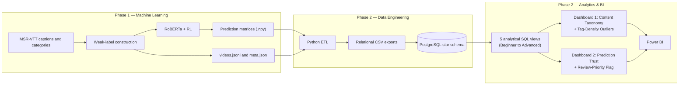
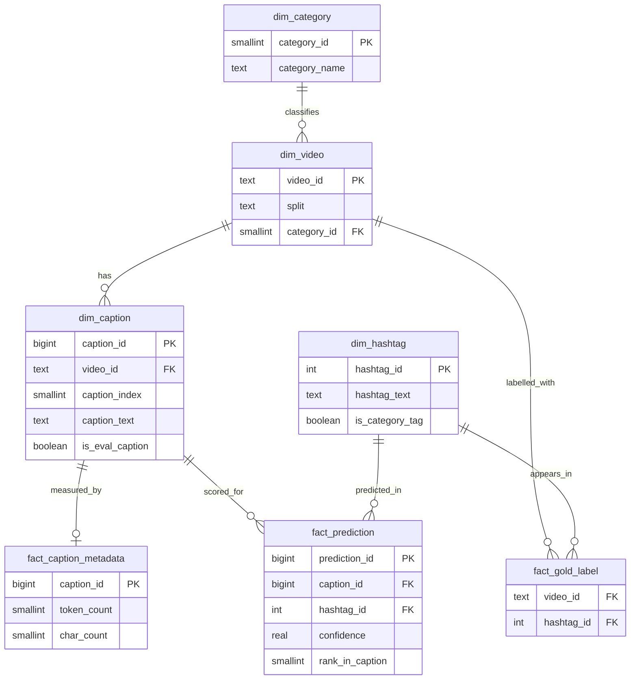

# Video Hashtag LLM — Phase 2: Data Warehouse & Business Intelligence

**A personal data engineering and business intelligence project** that transforms video-caption and hashtag-prediction outputs from Phase 1 into an analytical data warehouse and Power BI-ready datasets.

Phase 2 focuses on the operational questions that arise after a hashtag prediction model is deployed: what does the content catalogue look like, which hashtags and categories are related, and where should automated predictions be reviewed by a human?

> **Scope:** This phase builds a PostgreSQL star-schema warehouse, five analytical SQL views ordered as a progressive complexity ladder, and Power BI dashboards. 
**Related project:** [Video Hashtag LLM — Phase 1](https://github.com/phongvo2006-dev/video_hashtag_llm_F)

---

## 1. Project Overview

Phase 1 focused on the modelling task: comparing approaches for predicting hashtags from video captions and selecting RoBERTa fine-tuned with a set-level F1 reinforcement-learning objective (RoBERTa+RL) as the deployed model.

Phase 2 takes the outputs already produced by Phase 1 and builds an analytics layer around them. The goal is to make those outputs easier to query, monitor, and interpret from a business perspective.

### What this project delivers

- **Data warehouse:** a PostgreSQL star schema with four dimension tables and three fact tables.
- **Data pipeline:** a Python ETL script that transforms Phase 1 artifacts into relational CSV files.
- **Analytical SQL:** five simulated questions and circumstances designed to answer a specific business question.
- **Business analysis:** a documented business scenario, SQL query, result, insight, and recommendation for every view.
- **BI-ready datasets:** CSV exports that can be imported directly into Power BI.
- **Dashboard design:** a KPI and chart specification for two dashboards covering content taxonomy/tagging density and prediction trust/review priority.

### Phase 1 and Phase 2

| Phase | Focus | Main output |
|---|---|---|
| **Phase 1** | Dataset preparation, weak-label construction, model training and evaluation | A deployed RoBERTa+RL hashtag prediction model |
| **Phase 2** | Data engineering, dimensional modelling, analytical SQL, business analysis, and BI | PostgreSQL warehouse, five SQL views, documented business insights, and two Power BI dashboard datasets |

Phase 2 reads the following existing Phase 1 artifacts:

- `data/processed/videos.jsonl`
- `data/processed/meta.json`
- `results/preds/roberta_rl_val.npy`
- `results/preds/roberta_rl_test.npy`

The Phase 1 repository, training code, and model checkpoints remain unchanged.

---

## 2. Architecture



The pipeline separates data preparation, warehouse loading, analytical querying, and visualisation. This keeps the transformation logic reproducible and makes the SQL layer independently queryable.

---

## 3. Data Warehouse Design

### Star schema

The warehouse contains four dimension tables and three fact tables.



### Tables and dataset scale

The following row counts are from the loaded dataset.

| Table | Type | Rows | Description |
|---|---|---:|---|
| `dim_category` | Dimension | 20 | The 20 MSR-VTT video categories |
| `dim_video` | Dimension | 10,000 | One row per video, including its data split and category |
| `dim_caption` | Dimension | 200,000 | 20 captions per video; identifies the caption used for inference |
| `dim_hashtag` | Dimension | 367 | Union of gold-label and predicted hashtags; identifies category-name tags |
| `fact_gold_label` | Fact | 40,561 | Weakly supervised gold labels based on Phase 1's annotator consensus |
| `fact_caption_metadata` | Fact | 200,000 | Token and character counts for each caption |
| `fact_prediction` | Fact | 13,790 | RoBERTa+RL predictions retained at the deployment confidence threshold |

Schema definition: [`sql/01_schema.sql`](sql/01_schema.sql)

### Prediction confidence threshold

The pipeline materialises predictions with confidence ≥ 0.40 in `fact_prediction`.
This threshold follows the RoBERTa+RL operating point selected in Phase 1's validation threshold sweep (`results/metrics.json` → `val_threshold_sweep`). Reusing the deployment threshold keeps the warehouse aligned with the model's configured output rather than storing every possible hashtag for every caption.

---

## 4. Data Engineering Pipeline

The ETL layer is implemented in [`data_engineering/load_phase2.py`](data_engineering/load_phase2.py).

### Pipeline steps

1. **Extract** Phase 1 artifacts: `videos.jsonl`, `meta.json`, and the RoBERTa+RL validation and test prediction matrices.
2. **Transform** the source data into four relational CSV files.
3. **Filter and rank** predictions using the 0.40 confidence threshold.
4. **Export** the files for loading into PostgreSQL.

The script performs extraction and transformation only. It does not run model inference or training.

```bash
python data_engineering/load_phase2.py \
  --phase1-dir /path/to/video_hashtag_llm_F
```

### Generated CSV files

| File | Rows | Main fields |
|---|---:|---|
| `videos.csv` | 10,000 | `video_id`, `split`, `category_id`, `category_name` |
| `captions.csv` | 200,000 | `caption_id`, `video_id`, `caption_index`, `caption_text`, `is_eval_caption`, `token_count`, `char_count` |
| `gold_labels.csv` | 40,561 | `video_id`, `hashtag_text` |
| `predictions.csv` | 13,790 | `caption_id`, `video_id`, `hashtag_text`, `confidence`, `rank_in_caption` |

### Load data into PostgreSQL

```bash
bash sql/load.sh
```
---

## 5. Analytical SQL & Business Questions

Five SQL views turn the warehouse into reusable analytical datasets, ordered as a progressive **SQL-complexity ladder** — each view uses a more advanced technique than the last, building toward a combined, pre-ranked business decision.

| # | SQL view | Business question | SQL technique |
|---:|---|---|---|
| 1 | `vw_video_topic_tags` | What specific topic hashtags were assigned to a given video? | Plain joins, no aggregation |
| 2 | `vw_category_overview` | How large is each category, and how does it compare to the dataset-wide average? | `GROUP BY` + a scalar-subquery context column |
| 3 | `vw_high_tag_density_categories` | Which categories have an average tags-per-video above the dataset-wide average? | `GROUP BY ... HAVING` against a scalar subquery |
| 4 | `vw_confidence_by_category` | In which categories does the model predict with low confidence most often? | `GROUP BY`, ranked via `ORDER BY ... LIMIT` |
| 5 | `vw_category_review_priority` | Combining confidence and topic-coverage recall, which categories need priority review, and in what order? | 5 CTEs, an `EXISTS` subquery, and window functions (`AVG() OVER ()`, `RANK() OVER (...)`) |

### Business Analysis

This project addresses five business questions through analytical SQL views, each building on a more advanced SQL technique than the last. Each analysis includes:

- Business scenario and objective
- SQL technique and implementation
- Query results from this dataset (not invented figures)
- Key business insight
- Actionable recommendation, with its limitations stated explicitly

See **[Business Questions & SQL Analysis](sql/business_questions.md)** for the full write-up of all five questions.

---

## 6. Power BI

This repository contains the **Power BI input datasets**, rather than the `.pbix` dashboard files, under [`powerbi/data/`](powerbi/data/) in two layers:

1. **5 pre-computed SQL views** (`powerbi/data/*.csv`) — the output of every view in [`sql/03_views.sql`](sql/03_views.sql), already joined/aggregated/ranked by SQL. These are the primary source for the two dashboards below: Power BI just visualizes rows that are already business-question-ready.
2. **7 raw star-schema tables** (`powerbi/data/star_schema/*.csv`) — the 4 dimensions and 3 facts underneath those views, exported as-is. These are for building an actual relationship model *inside* Power BI (Model view) and writing your own DAX measures on top, independent of the SQL layer — useful as a cross-check, or for any slicing the 5 fixed views don't already cover.

Both are imported the same way: **Get Data → Text/CSV**, one file per table/view.

### Star schema relationships (layer 2)

If you load the 7 `star_schema/` tables, set up these relationships in Power BI's Model view (all single-direction, "one" side listed first):

| From (1) | To (*) | Join column |
|---|---|---|
| `dim_category` | `dim_video` | `category_id` |
| `dim_video` | `dim_caption` | `video_id` |
| `dim_video` | `fact_gold_label` | `video_id` |
| `dim_caption` | `fact_caption_metadata` | `caption_id` (1-to-1) |
| `dim_caption` | `fact_prediction` | `caption_id` |
| `dim_hashtag` | `fact_gold_label` | `hashtag_id` |
| `dim_hashtag` | `fact_prediction` | `hashtag_id` |

`dim_caption.caption_text` is intentionally **not** included in `dim_caption.csv` — none of the planned visuals display individual caption text, and all 200,000 rows of it would roughly double the model's size for no analytical benefit. Every column needed for the relationships above is kept.

With that model in place, DAX measures such as these reproduce (and let you extend) the same numbers the SQL views already compute:

```dax
Total Videos        = DISTINCTCOUNT(dim_video[video_id])
Avg Tags per Video  = DIVIDE(COUNTROWS(fact_gold_label), [Total Videos])
Avg Confidence      = AVERAGE(fact_prediction[confidence])
Pct Low Confidence  = DIVIDE(
                           CALCULATE(COUNTROWS(fact_prediction), fact_prediction[confidence] < 0.5),
                           COUNTROWS(fact_prediction)
                       )
```

The dashboard design consists of two pages, built primarily from the five SQL views, with the star-schema model available alongside for any additional cross-filtering:

1. **Content Taxonomy Overview** — catalogue size, category distribution, per-video topic-tag drill-in, and the above-average tag-density outlier list.
2. **Prediction Trust & Topic Coverage** — model confidence and the combined, pre-ranked review-priority flag.

The planned report uses shared `category_name` and `split` slicers across the pages.

### Dashboard 1 — Content Taxonomy Overview

**Business question:** What does the content catalogue look like, which categories account for the largest share of it, and which ones already run denser tagging than typical?

**Data sources:** `vw_category_overview`, `vw_video_topic_tags`, `vw_high_tag_density_categories`

Selected results from this dataset:

- 10,000 videos across 20 categories
- 367 distinct hashtags
- 4.06 average gold-label hashtags per video
- `sports` is the largest category, with 1,108 videos (11.1% of the catalogue)
- `food` has the highest average number of tags per video (5.15), while `news` has the lowest (2.98)
- Only **7 of 20 categories** (`food`, `sports`, `animation`, `music`, `family`, `autos`, `cooking`) are above the 4.06 dataset-wide average — a SQL-computed (`GROUP BY ... HAVING` against a subquery) outlier list, not an eyeballed one

**Planned visuals**
- KPI cards for total videos, categories, hashtags, and average tags per video
- Category-level video-count and hashtag-count bar charts
- Category summary matrix
- Video-level topic-tag drill-through table (backed by `vw_video_topic_tags`), filtered to one video or category at a time
- Highlighted callout list of the 7 above-average tag-density categories

### Dashboard 2 — Prediction Trust & Topic Coverage

**Business question:** How reliable are the deployed model's predictions, and — combining confidence with topic-coverage recall — which categories need priority review, in what order?

**Data sources:** `vw_confidence_by_category`, `vw_category_review_priority`

Selected results from this dataset:

- Overall average prediction confidence: **0.7712**
- Predictions below 0.50 confidence: **13.8%**
- `education` has the highest share of low-confidence predictions (20.9%); `cooking` has the lowest average confidence (0.7069)
- Combining confidence **and** topic-coverage recall (5 CTEs, `EXISTS`, and two window functions), **6 of 20 categories** — `education`, `scitech`, `ads`, `news`, `tvshow`, `travel` — are flagged `High Priority Review` and pre-ranked by severity (`review_rank`). Note this correctly **excludes** `cooking` despite its lowest raw confidence, because its coverage recall is actually above average

The dashboard combines confidence and topic coverage to help identify categories that may need closer human review. Confidence and coverage are tracked as separate signals, and then combined into one pre-ranked flag — a stricter, more defensible list than either diagnostic alone.

**Planned visuals**
- Category ranking by percentage of low-confidence predictions
- Confidence-versus-coverage scatter plot, one point per category, colored by the SQL-computed `review_priority` flag
- A flat, pre-ranked review-priority table (`review_rank`, exportable "where to look first" list)
- Confidence-threshold filter

### Regenerate Power BI datasets

After the SQL views have been created, run:

```bash
bash sql/export_views.sh        # the 5 pre-computed views -> powerbi/data/ and sql/results/
bash sql/export_star_schema.sh  # the 7 raw star-schema tables -> powerbi/data/star_schema/
```

---

## 7. Quickstart & Reproducibility

### Prerequisites

- Python 3
- NumPy
- PostgreSQL 16
- Access to the processed outputs and prediction files generated by Phase 1

No GPU is required. Phase 2 does not train or run a model.

### Run the pipeline

```bash
# 1. Clone this repository
git clone https://github.com/phongvo2006-dev/video_hashtag_llm_Phase-2.git
cd video_hashtag_llm_Phase-2

# 2. Generate relational CSV files from Phase 1 artifacts
python data_engineering/load_phase2.py \
  --phase1-dir /path/to/video_hashtag_llm_F

# 3. Create the PostgreSQL database
createdb video_hashtag_phase2

# 4. Create the schema and load the generated CSV files
bash sql/load.sh

# 5. Create the five analytical views
psql -d video_hashtag_phase2 -f sql/03_views.sql

# 6. Export the view results for Power BI
bash sql/export_views.sh
```

The workflow runs locally using flat-file processing, PostgreSQL, and `\copy`. Replace `/path/to/video_hashtag_llm_F` with the local path to your Phase 1 repository.

---

## 8. Repository Structure

```text
video_hashtag_llm_Phase-2/
├── data_engineering/
│   ├── load_phase2.py        # ETL: Phase 1 artifacts → relational CSV files
│   └── exports/              # Generated CSV files for warehouse loading
├── sql/
│   ├── 01_schema.sql         # Star-schema DDL
│   ├── 02_load.sql           # Staging and warehouse-loading logic
│   ├── 03_views.sql          # Five analytical SQL views (Beginner → Advanced), with business-purpose comments
│   ├── business_questions.md # Business scenario, SQL, result, insight, and recommendation per view
│   ├── load.sh               # Create schema and load CSV files
│   ├── export_views.sh       # Export the 5 SQL views to CSV
│   ├── export_star_schema.sh # Export the 7 raw star-schema tables to CSV
│   └── results/              # Executed SQL view results
├── powerbi/
│   └── data/                 # CSV datasets for Power BI
│       ├── *.csv             # The 5 pre-computed views (primary dashboard source)
│       └── star_schema/      # The 4 dims + 3 facts, for relationships/DAX in Power BI
└── README.md
```

---

## 9. Tech Stack

| Area | Technologies |
|---|---|
| Data engineering | Python, NumPy, CSV and JSON processing |
| Data warehouse | PostgreSQL 16, dimensional modelling, star schema |
| Data analytics | SQL views, joins, aggregations, window functions |
| Business intelligence | Power BI, KPI design, interactive filtering and data visualisation |

---

## 10. Project Context

This repository is **Phase 2** of the Video Hashtag LLM project.

Phase 1 covers dataset preparation, weak-label construction, model comparison, and the selection of RoBERTa+RL as the deployed model. It is available here:

[**phongvo2006-dev/video_hashtag_llm_F**](https://github.com/phongvo2006-dev/video_hashtag_llm_F)

Phase 2 extends that work beyond model development by building the data and analytics layer needed to inspect the content catalogue and monitor the deployed model's outputs.
