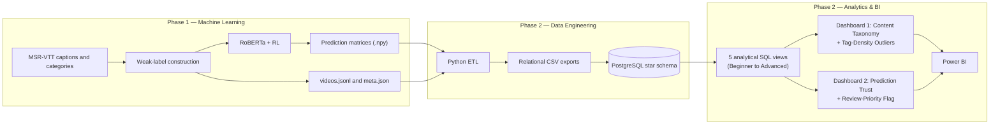
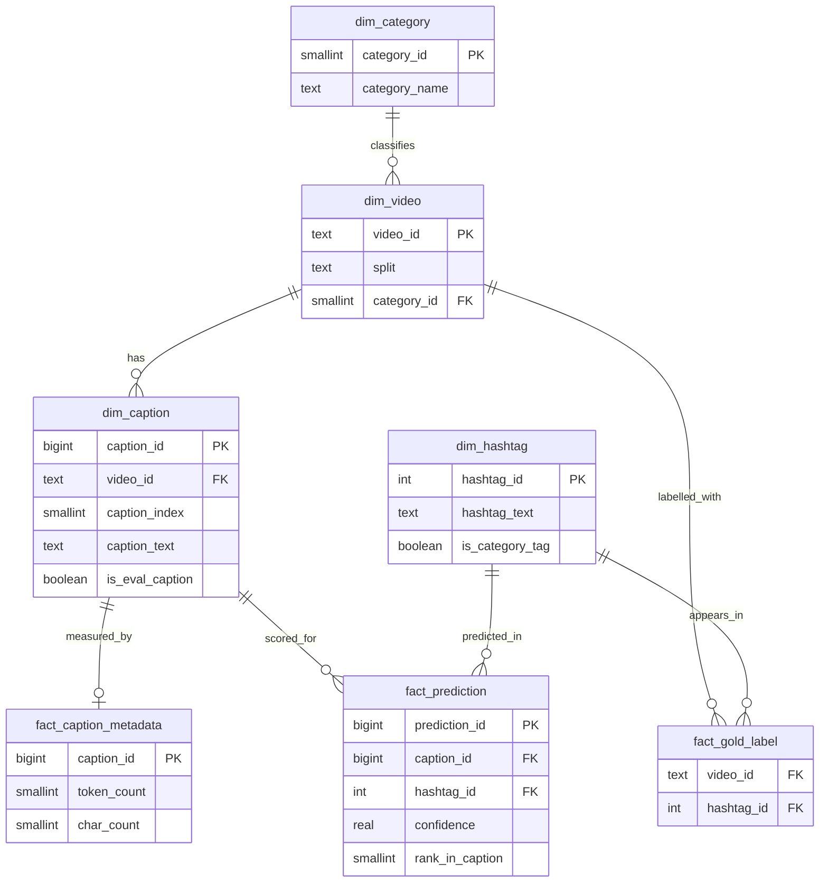
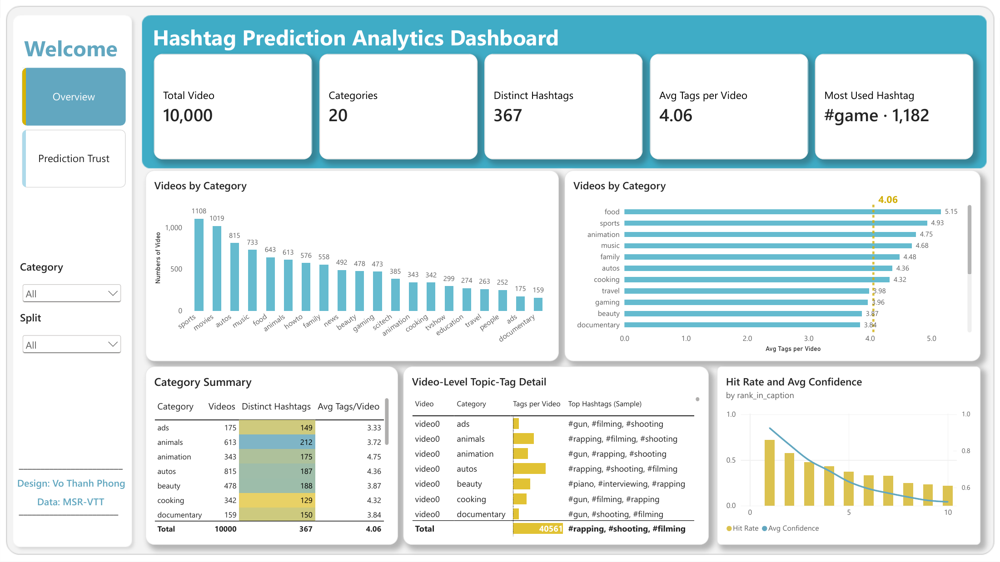
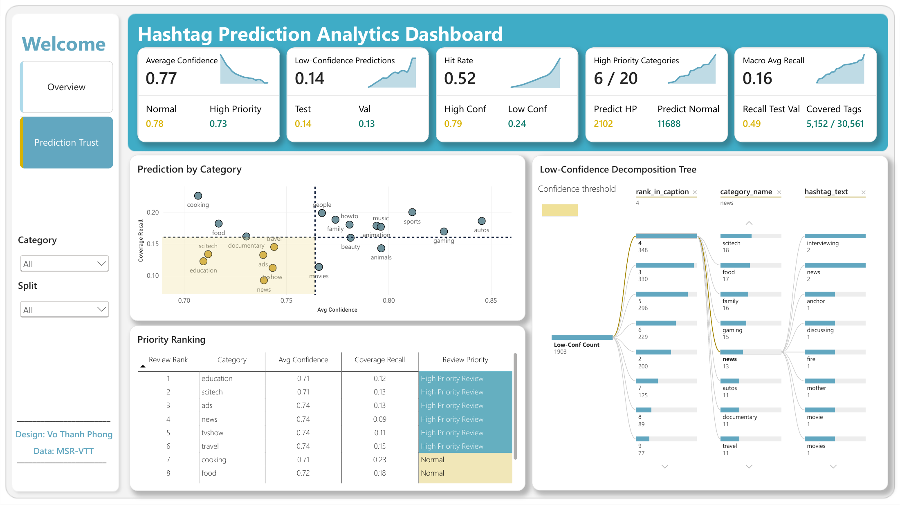

# Video Hashtag LLM — Phase 2: Data Warehouse & Business Intelligence

A personal data engineering and business intelligence project that transforms video-caption and hashtag-prediction outputs from Phase 1 into an analytical data warehouse and Power BI-ready datasets.

Phase 2 focuses on the operational questions that arise after a hashtag prediction model is deployed: what does the content catalogue look like, which hashtags and categories are related, and where should automated predictions be reviewed by a human?

> **Scope:** This phase builds a PostgreSQL star-schema warehouse, five analytical SQL views ordered as a progressive complexity ladder, and Power BI dashboards. 
**Related project:** [Video Hashtag LLM — Phase 1](https://github.com/phongvo2006-dev/video_hashtag_llm_F)

---

## 1. Project Overview

Phase 1 focused on the modelling task: comparing approaches for predicting hashtags from video captions and selecting RoBERTa fine-tuned with a set-level F1 reinforcement-learning objective (RoBERTa+RL) as the deployed model.

Phase 2 takes the outputs already produced by Phase 1 and builds an analytics layer around them. The goal is to make those outputs easier to query, monitor, and interpret from a business perspective.

### What this project delivers

- **Data warehouse:** a PostgreSQL star schema with four dimension tables and three fact tables.
- **Data pipeline:** a Python ETL script that transforms Phase 1 artifacts into relational CSV files.
- **Analytical SQL:** five simulated questions and circumstances designed to answer a specific business question.
- **Business analysis:** a documented business scenario, SQL query, result, insight, and recommendation for every view.
- **BI-ready datasets:** CSV exports that can be imported directly into Power BI.
- **Power BI dashboard:** a two-page report (`.pbix` plus PDF export) covering content taxonomy/tagging density and prediction trust/review priority.

### Phase 1 and Phase 2

| Phase | Focus | Main output |
|---|---|---|
| **Phase 1** | Dataset preparation, weak-label construction, model training and evaluation | A deployed RoBERTa+RL hashtag prediction model |
| **Phase 2** | Data engineering, dimensional modelling, analytical SQL, business analysis, and BI | PostgreSQL warehouse, five SQL views, documented business insights, and a two-page Power BI dashboard |

Phase 2 reads the following existing Phase 1 artifacts:

- `data/processed/videos.jsonl`
- `data/processed/meta.json`
- `results/preds/roberta_rl_val.npy`
- `results/preds/roberta_rl_test.npy`

The Phase 1 repository, training code, and model checkpoints remain unchanged.

---

## 2. Architecture



The pipeline separates data preparation, warehouse loading, analytical querying, and visualisation. This keeps the transformation logic reproducible and makes the SQL layer independently queryable.

---

## 3. Data Warehouse Design

### Star schema

The warehouse contains four dimension tables and three fact tables.



### Tables and dataset scale

The following row counts are from the loaded dataset.

| Table | Type | Rows | Description |
|---|---|---:|---|
| `dim_category` | Dimension | 20 | The 20 MSR-VTT video categories |
| `dim_video` | Dimension | 10,000 | One row per video, including its data split and category |
| `dim_caption` | Dimension | 200,000 | 20 captions per video; identifies the caption used for inference |
| `dim_hashtag` | Dimension | 367 | Union of gold-label and predicted hashtags; identifies category-name tags |
| `fact_gold_label` | Fact | 40,561 | Weakly supervised gold labels based on Phase 1's annotator consensus |
| `fact_caption_metadata` | Fact | 200,000 | Token and character counts for each caption |
| `fact_prediction` | Fact | 13,790 | RoBERTa+RL predictions retained at the deployment confidence threshold |

Schema definition: [`sql/01_schema.sql`](sql/01_schema.sql)

### Prediction confidence threshold

The pipeline materialises predictions with confidence ≥ 0.40 in `fact_prediction`.
This threshold follows the RoBERTa+RL operating point selected in Phase 1's validation threshold sweep (`results/metrics.json` → `val_threshold_sweep`). Reusing the deployment threshold keeps the warehouse aligned with the model's configured output rather than storing every possible hashtag for every caption.

---

## 4. Data Engineering Pipeline

The ETL layer is implemented in [`data_engineering/load_phase2.py`](data_engineering/load_phase2.py).

### Pipeline steps

1. **Extract** Phase 1 artifacts: `videos.jsonl`, `meta.json`, and the RoBERTa+RL validation and test prediction matrices.
2. **Transform** the source data into four relational CSV files.
3. **Filter and rank** predictions using the 0.40 confidence threshold.
4. **Export** the files for loading into PostgreSQL.

The script performs extraction and transformation only. It does not run model inference or training.

```bash
python data_engineering/load_phase2.py \
  --phase1-dir /path/to/video_hashtag_llm_F
```

### Generated CSV files

| File | Rows | Main fields |
|---|---:|---|
| `videos.csv` | 10,000 | `video_id`, `split`, `category_id`, `category_name` |
| `captions.csv` | 200,000 | `caption_id`, `video_id`, `caption_index`, `caption_text`, `is_eval_caption`, `token_count`, `char_count` |
| `gold_labels.csv` | 40,561 | `video_id`, `hashtag_text` |
| `predictions.csv` | 13,790 | `caption_id`, `video_id`, `hashtag_text`, `confidence`, `rank_in_caption` |

### Load data into PostgreSQL

```bash
bash sql/load.sh
```
---

## 5. Analytical SQL & Business Questions

Five SQL views turn the warehouse into reusable analytical datasets, ordered as a progressive **SQL-complexity ladder** — each view uses a more advanced technique than the last, building toward a combined, pre-ranked business decision.

| # | SQL view | Business question | SQL technique |
|---:|---|---|---|
| 1 | `vw_video_topic_tags` | What specific topic hashtags were assigned to a given video? | `INNER JOIN`s and a `WHERE` filter, no aggregation |
| 2 | `vw_category_overview` | How large is each category, and how does it compare to the dataset-wide average? | `GROUP BY` + a scalar-subquery context column |
| 3 | `vw_high_tag_density_categories` | Which categories have an average tags-per-video above the dataset-wide average? | `GROUP BY ... HAVING` against a scalar subquery |
| 4 | `vw_confidence_by_category` | In which categories does the model predict with low confidence most often? | `GROUP BY` with conditional aggregation over evaluation captions |
| 5 | `vw_category_review_priority` | Combining confidence and topic-coverage recall, which categories need priority review, and in what order? | CTEs, a correlated `EXISTS` subquery, and window functions (`AVG() OVER ()`, `RANK() OVER (...)`) |

### Shared metric definitions

- **Tag density (views 2–3):** counts all gold labels per video, including the category-name label, so category and dataset-wide averages use the same definition.
- **Topic hashtags (views 1 and 5):** exclude category-name labels (`is_category_tag = FALSE`).
- **Evaluation predictions (view 4):** use only predictions attached to captions where `is_eval_caption = TRUE`.
- **Low-confidence threshold:** a prediction is low-confidence when `confidence < 0.50`. This is an operational threshold, not a calibrated probability and not proof that a prediction is wrong.
- **Topic coverage (view 5):** a gold `(video, hashtag)` pair counts as covered only if that same hashtag was predicted for that same video; predicting it for a different video in the category does not count.
- **Priority rule (view 5):** a category is `High Priority Review` only when its average confidence **and** its coverage recall are both below the dataset-wide benchmark. Those categories are ranked first, then ordered by lower confidence and lower coverage.

### Business Analysis

Each of the five views is documented in **[Business Questions & SQL Analysis](sql/business_questions.md)** with:

- Business scenario and objective
- The business question and the SQL technique used
- An example query
- How to interpret the result, including the metric definitions and their limitations
- Business use

> **Validation note:** the SQL definitions were revised for consistent populations and metric definitions, so the write-up does not quote result tables. Re-run the queries against the current `video_hashtag_phase2` database and refresh any reported numbers before publishing them.

---

## 6. Power BI

The final deliverable of Phase 2 is a two-page Power BI report, **Hashtag Prediction Analytics Dashboard**, built on the PostgreSQL star schema and a set of DAX measures. The report turns the warehouse into something a content or model owner can actually use: *what does the catalogue look like?* and *where can we trust the model's hashtags, and where should a human review them first?*

| File | Description |
|---|---|
| [`Hashtag Prediction Analysis Dashboard_Võ Thành Phong.pbix`](powerbi/data/Hashtag%20Prediction%20Analysis%20Dashboard_V%C3%B5%20Th%C3%A0nh%20Phong.pbix) | The editable Power BI report (open with Power BI Desktop) |
| [`Hashtag Prediction Analysis Dashboard _ Võ Thành Phong.pdf`](powerbi/data/Hashtag%20Prediction%20Analysis%20Dashboard%20_%20V%C3%B5%20Th%C3%A0nh%20Phong.pdf) | A 2-page PDF export, for readers without Power BI |
| [`powerbi/images/`](powerbi/images/) | The page screenshots shown below |

The report has two pages, switched with the left-hand navigation. Both pages share the same left panel: page navigation plus **Category** and **Split** (train / val / test) slicers.

### Dashboard 1 — Overview (content taxonomy)



**Business question:** What does the content catalogue look like, which categories account for the largest share of it, and which ones already run denser tagging than typical?

**What is on the page**

- **5 KPI cards:** Total Videos (10,000), Categories (20), Distinct Hashtags (367), Avg Tags per Video (4.06), and Most Used Hashtag (`#game`, 1,182 videos).
- **Videos by Category** (column chart): catalogue size per category, largest first.
- **Avg Tags per Video by category** (bar chart): each category against the 4.06 dataset-wide average line, showing at a glance which ones are denser than typical.
- **Category Summary** (table): videos, distinct hashtags, and average tags per video for each category.
- **Video-Level Topic-Tag Detail** (table): tags per video and a sample of its top hashtags; filtered by the category slicer to drill into a single category.
- **Hit Rate and Avg Confidence by `rank_in_caption`** (combo chart): how prediction quality and confidence change as the model moves down its ranked hashtag list.

**Selected results**

- 10,000 videos across 20 categories, 367 distinct hashtags, 4.06 average gold-label hashtags per video.
- `sports` is the largest category (1,108 videos, 11.1% of the catalogue).
- `food` has the highest average number of tags per video (5.15); `news` has the lowest (2.98).
- Only **7 of 20 categories** (`food`, `sports`, `animation`, `music`, `family`, `autos`, `cooking`) are above the 4.06 average — a SQL-computed (`GROUP BY ... HAVING` against a subquery) outlier list, not an eyeballed one.

**Data sources:** `vw_category_overview`, `vw_video_topic_tags`, `vw_high_tag_density_categories`, plus the star-schema tables for the slicer-driven measures.

### Dashboard 2 — Prediction Trust (confidence and topic coverage)



**Business question:** How reliable are the deployed model's predictions, and — combining confidence with topic-coverage recall — which categories need priority review, in what order?

**What is on the page**

- **5 KPI cards**, each with a sparkline and reference sub-metrics:

  | KPI | Value | Reference labels |
  |---|---|---|
  | Average Confidence | 0.77 | Normal 0.78 · High Priority 0.73 |
  | Low-Confidence Predictions | 0.14 (13.8%) | Test 0.14 · Val 0.13 |
  | Hit Rate | 0.52 | High Conf 0.79 · Low Conf 0.24 |
  | High Priority Categories | 6 / 20 | Predictions: High Priority 2,102 · Normal 11,688 |
  | Macro Avg Recall | 0.16 | Test+Val recall 0.49 · Covered tags 5,152 / 30,561 |

- **Prediction by Category** (scatter): one point per category — average confidence (x) against coverage recall (y), with dashed average lines and a shaded *High Priority* zone where both signals are below average.
- **Priority Ranking** (table): the pre-ranked `review_rank` list with confidence, coverage recall, and a colour-coded `Review Priority` flag — the "where to look first" list.
- **Low-Confidence Decomposition Tree:** starts from the low-confidence prediction count and splits by `rank_in_caption` → `category_name` → `hashtag_text`, so a reviewer can drill from "where in the ranking" down to individual hashtags.
- **Confidence threshold** (what-if parameter): changes the cut-off that defines "low confidence" (default 0.50) and updates the KPI cards and decomposition tree.

### Data model and DAX

The report is built on two layers of CSV in [`powerbi/data/`](powerbi/data/), both imported with **Get Data → Text/CSV**:

1. **5 pre-computed SQL views** (`powerbi/data/*.csv`) — the output of every view in [`sql/03_views.sql`](sql/03_views.sql), already joined, aggregated and ranked by SQL.
2. **7 star-schema tables** (`powerbi/data/star_schema/*.csv`) — the 4 dimensions and 3 facts underneath those views, related in Power BI's Model view and used by the DAX measures and slicers.

Relationships (all single-direction, "one" side listed first):

| From (1) | To (*) | Join column |
|---|---|---|
| `dim_category` | `dim_video` | `category_id` |
| `dim_video` | `dim_caption` | `video_id` |
| `dim_video` | `fact_gold_label` | `video_id` |
| `dim_caption` | `fact_caption_metadata` | `caption_id` (1-to-1) |
| `dim_caption` | `fact_prediction` | `caption_id` |
| `dim_hashtag` | `fact_gold_label` | `hashtag_id` |
| `dim_hashtag` | `fact_prediction` | `hashtag_id` |

`dim_caption.caption_text` is intentionally **not** included in `dim_caption.csv` — no visual displays individual caption text, and all 200,000 rows of it would roughly double the model's size for no analytical benefit.

Core measures (the report adds further ones for the reference labels, sparklines and review flag):

```dax
Total Videos        = DISTINCTCOUNT(dim_video[video_id])
Avg Tags per Video  = DIVIDE(COUNTROWS(fact_gold_label), [Total Videos])
Avg Confidence      = AVERAGE(fact_prediction[confidence])

-- Threshold comes from the what-if parameter; the VAR avoids using a measure
-- inside a CALCULATE filter predicate
Low-Conf Count =
VAR t = [Confidence Threshold Value]
RETURN CALCULATE(COUNTROWS(fact_prediction), fact_prediction[confidence] < t)

Low Conf % = DIVIDE([Low-Conf Count], COUNTROWS(fact_prediction))
```

### Regenerate Power BI datasets

After the SQL views have been created, run:

```bash
bash sql/export_views.sh        # the 5 pre-computed views -> powerbi/data/ and sql/results/
bash sql/export_star_schema.sh  # the 7 raw star-schema tables -> powerbi/data/star_schema/
```

Then open the `.pbix` and use **Refresh**; if the CSV files have moved, update the source paths under **Transform data → Data source settings**.

---

## 7. Quickstart & Reproducibility

### Prerequisites

- Python 3
- NumPy
- PostgreSQL 16
- Access to the processed outputs and prediction files generated by Phase 1

No GPU is required. Phase 2 does not train or run a model.

### Run the pipeline

```bash
# 1. Clone this repository
git clone https://github.com/phongvo2006-dev/video_hashtag_llm_Phase-2.git
cd video_hashtag_llm_Phase-2

# 2. Generate relational CSV files from Phase 1 artifacts
python data_engineering/load_phase2.py \
  --phase1-dir /path/to/video_hashtag_llm_F

# 3. Create the PostgreSQL database
createdb video_hashtag_phase2

# 4. Create the schema and load the generated CSV files
bash sql/load.sh

# 5. Create the five analytical views
psql -d video_hashtag_phase2 -f sql/03_views.sql

# 6. Export the view results for Power BI
bash sql/export_views.sh
```

The workflow runs locally using flat-file processing, PostgreSQL, and `\copy`. Replace `/path/to/video_hashtag_llm_F` with the local path to your Phase 1 repository.

---

## 8. Repository Structure

```text
video_hashtag_llm_Phase-2/
├── data_engineering/
│   ├── load_phase2.py        # ETL: Phase 1 artifacts → relational CSV files
│   └── exports/              # Generated CSV files for warehouse loading
├── sql/
│   ├── 01_schema.sql         # Star-schema DDL
│   ├── 02_load.sql           # Staging and warehouse-loading logic
│   ├── 03_views.sql          # Five analytical SQL views (Beginner → Advanced), with business-purpose comments
│   ├── business_questions.md # Business scenario, SQL, result, insight, and recommendation per view
│   ├── load.sh               # Create schema and load CSV files
│   ├── export_views.sh       # Export the 5 SQL views to CSV
│   ├── export_star_schema.sh # Export the 7 raw star-schema tables to CSV
│   └── results/              # Executed SQL view results
├── powerbi/
│   ├── data/                 # Power BI report and its CSV datasets
│   │   ├── *.pbix            # The Power BI report (2 pages)
│   │   ├── *.pdf             # PDF export of the report
│   │   ├── *.csv             # The 5 pre-computed views
│   │   └── star_schema/      # The 4 dims + 3 facts, for relationships/DAX in Power BI
│   └── images/               # Dashboard screenshots used in this README
└── README.md
```

---

## 9. Tech Stack

| Area | Technologies |
|---|---|
| Data engineering | Python, NumPy, CSV and JSON processing |
| Data warehouse | PostgreSQL 16, dimensional modelling, star schema |
| Data analytics | SQL views, joins, aggregations, window functions |
| Business intelligence | Power BI, KPI design, interactive filtering and data visualisation |

---

## 10. Project Context

This repository is **Phase 2** of the Video Hashtag LLM project.

Phase 1 covers dataset preparation, weak-label construction, model comparison, and the selection of RoBERTa+RL as the deployed model. It is available here:

[**phongvo2006-dev/video_hashtag_llm_F**](https://github.com/phongvo2006-dev/video_hashtag_llm_F)

Phase 2 extends that work beyond model development by building the data and analytics layer needed to inspect the content catalogue and monitor the deployed model's outputs.
